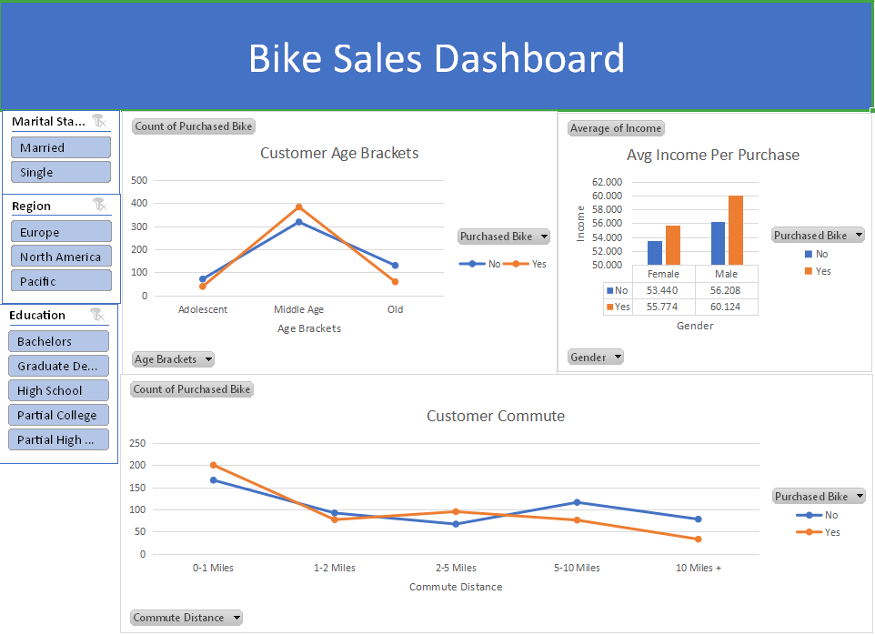

# Bike Sales Dashboard (Excel)

Interactive Excel dashboard analyzing 1,000 bike buyers to find who is most likely to purchase a bike.

## Steps
- **Data cleaning:** removed 26 duplicate rows, replaced codes (M/S, M/F) with full words
- **Feature engineering:** created `Age Brackets` with a nested IF formula (Adolescent / Middle Age / Old)
- **Pivot tables:** average income by gender, purchases by commute distance and age bracket
- **Dashboard:** 3 charts + slicers (Marital Status, Region, Education) connected to all pivots

## Key Insights
- Buyers have higher average income than non-buyers (both genders)
- Customers commuting 0–1 miles buy the most bikes; purchases drop as distance increases
- Middle-aged customers (31–54) are the largest buyer group

## Tools
Excel (WPS Spreadsheets) – Pivot Tables, Pivot Charts, Slicers, IF formulas

*Project based on Alex The Analyst's Data Analyst Bootcamp.*
